# Improved Particle Swarm Optimization (PSO) algorithm tuning of PID parameters and comparison with Grey Wolf Algorithm, with MATLAB code attached.

Today's theme is: Utilizing Levy flight and Chaos Map for particle swarm optimization to tune PID parameters of various common transfer functions. For an improved approach, please refer to this article. The particle swarm optimization algorithm based on the improved Levy flight and Chaos Map (10 different chaos maps can be switched at will) is provided along with MATLAB code.
There are many methods for tuning PID parameters, including orthogonal experimental design, pole placement method, and another category of intelligent optimization algorithms, such as genetic algorithms, particle swarm optimization, neural network algorithms. Today, we bring you a session on using the Levy flight and Chaos Map-based particle swarm optimization algorithm to tune PID parameters of various common transfer functions, comparing the time domain indicators before and after tuning with the previous session's Grey Wolf Algorithm.
The transfer function still includes five types, which essentially covers all common transfer functions.
The results graph of the improved particle swarm optimization algorithm tuning PID under step response is as follows:
01
Before and after optimization by chaosLPSO:
Console input results:
02
Before and after optimization by chaosLPSO:
Console input results:
03
Before and after optimization by chaosLPSO:
Console input results:
04
Before and after optimization by chaosLPSO:
Console input results:
05
Before and after optimization by chaosLPSO:
Console input results:
Conclusion: Compared with the Grey Wolf Algorithm, it can be seen that in the tuning of PID parameters for low-order systems, regardless of which intelligent optimization algorithm is used, the final effect should be quite similar.
Code:
①The code uses 10 different chaos maps to improve the particle swarm optimization algorithm, allowing for the free switching of these 10 chaos maps.

## Images

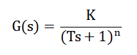
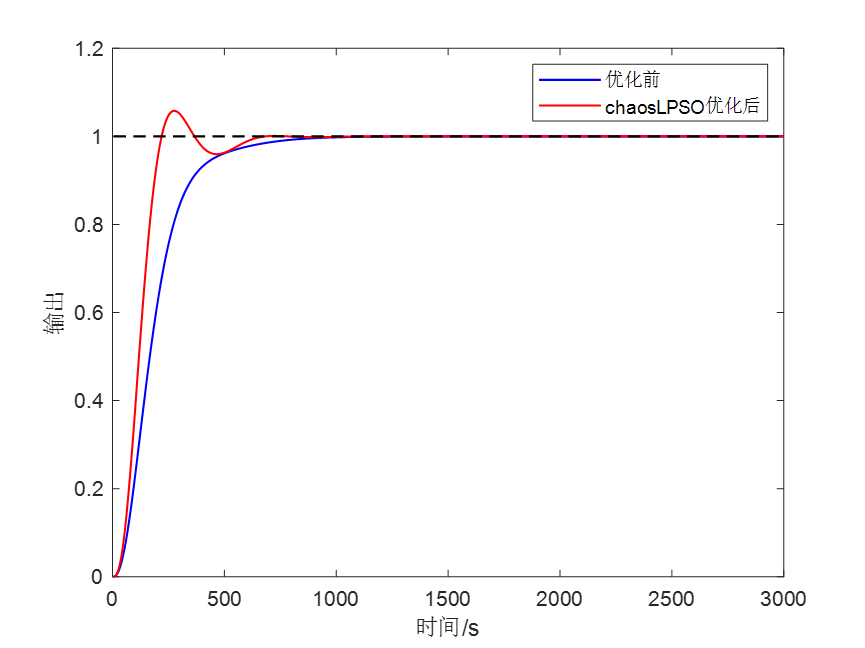
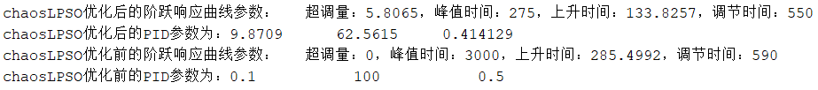
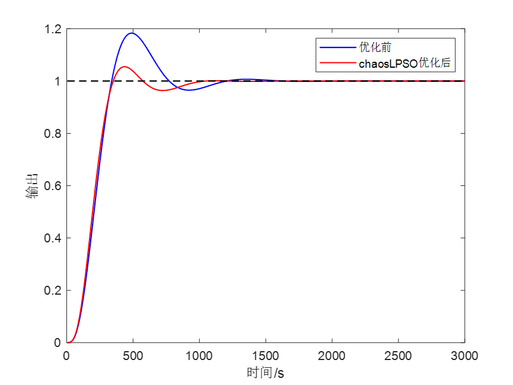
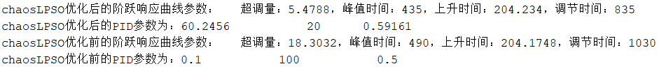
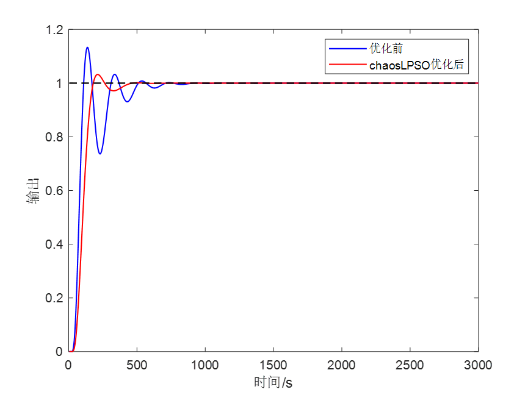
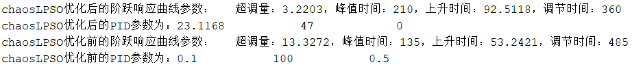
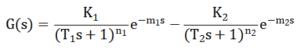
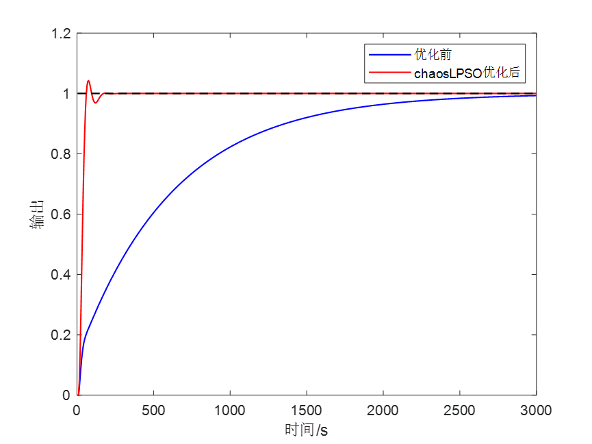
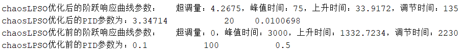
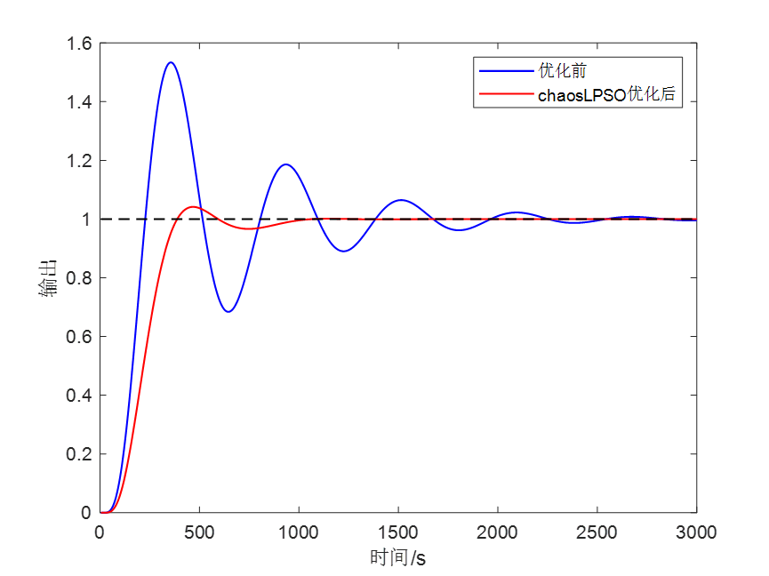
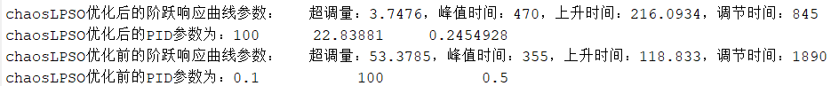

<!-- PAYMENT_BLOCK -->

## Get this dataset

- Payment link (Stripe): [Buy now](https://buy.stripe.com/3cs8yP7sY87d0vu9AB)
- Payment QR code: 

<!-- /PAYMENT_BLOCK -->
